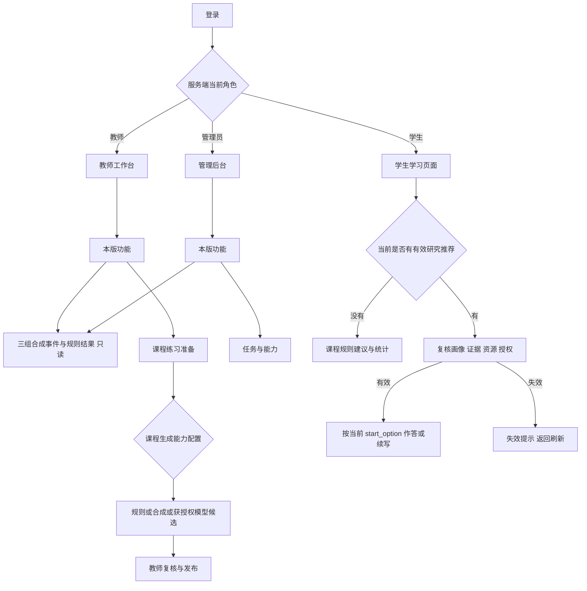

# 产品说明书增补：V2.1 阶段集成

版本日期：2026-11-26。适用于独立分支 `integration/demo-v2.1-2026-11-26`。本文件增补既有产品说明书，不修改既有角色体系、课程归属和数据库 schema。

## 顶层目标与范围

最终目标是以有效学习证据支撑“教学资源生成—动态画像—自适应推荐—教学质量反馈”的循环，并为学生、教师和管理员提供各自授权范围内的操作。教师承担教学复核、发布与必要的评分/干预；管理员管理配置、任务与访问范围。

V2.1 的目标是把三组代码的真实能力放进统一 Demo，并让用户区分可操作功能、合成预览和未接通能力。它不验收研究效果，不规定必须采用国产芯片，也不以是否训练/微调作为单独完成标准；后续按研究能力和验证结果评价。

## 页面清单及跳转变化

| 页面 | 路径/入口 | 本次变化 | 操作与下一页 |
| --- | --- | --- | --- |
| 教师“本版功能” | `/education/teacher/integration`，教师侧栏 | 新增四模块状态卡、合成时序预览、加载失败重试 | 切换三种场景；“打开练习准备”进入可访问课程的生成页，无课程时返回课程列表 |
| 管理员“本版功能” | `/education/admin/integration`，管理员侧栏 | 同一合成预览与能力说明 | “查看任务与能力”进入 `/education/admin/operations` |
| 教师练习准备 | `/education/teacher/courses/{course_id}/generate` | 延续 A 分支接入；按配置提供规则/合成/模型候选入口，模型调用需明确授权 | 选择资料、知识目标 → 候选生成 → 回看版本 → 教师复核 → 按授权发布 |
| 学生学习状态/建议 | 既有 S08 学习状态入口 | 未接通研究画像时继续展示已有成绩统计/课程规则建议；已校验研究推荐保留来源与版本 | 打开当前合法推荐练习；失效则返回刷新或查看其他建议 |
| 教师学情 | 既有 T11 学生学习状态入口 | 保留现有统计；不把离线格式化函数标为已接通研究画像页面 | 研究版本与真实事件页面接线留至 V2.2 |
| 推荐练习打开与开始 | 既有版本化推荐路径 | 打开及开始前复核资格，返回并使用 `start_option` | `normal` 使用普通次数；`grant` 使用指定补交/订正授权；`resume` 续写指定草稿 |
| 学生访问“本版功能” | 不提供侧栏入口 | 客户端拒绝显示，后端预览 API 返回 403 | 不回落读取真实学生数据 |



图中的合成预览不向画像、推荐、成绩流入数据。真正的研究事件闭环尚未接线。

## 新增与变更 API

下表路径均以 `/api/v1/education` 为前缀。认证使用本地系统既有会话和服务端 Actor，不使用浏览器自报角色。

| 方法与路径 | 行为 | 关键返回/限制 |
| --- | --- | --- |
| **新增** `GET /research-preview` | 当前教师/管理员读取预设合成序列及规则计算结果；读取身份权限所需业务信息，但不读取真实学生学习记录 | `release=V2.1`、`data_source=synthetic_demo_data`、`learning_evidence_eligible=false`、`method_kind=rule_sequence_preview`、`model_called=false`；`Cache-Control: no-store` |
| `POST /courses/{course}/students/{student}/recommendations/jobs` | 本人/课程权限检查后明确拒绝创建自动推荐任务 | `503 RECOMMENDATION_EXECUTION_UNAVAILABLE`；不写 queued task；无生产调度器时不可用配置开关伪装接通 |
| `POST /courses/{course}/students/{student}/recommendations/jobs/{task}/import` | 保留服务端既有任务的可信产物导入 | 仍检查归属、画像版本、哈希、取消状态、证据与当前资源授权；不接受浏览器任意上传产物冒充可信执行 |
| `GET /courses/{course}/students/{student}/recommendations/{version}/exercises/{binding}` | 按当前推荐版本查找该练习，再读取授权 binding | 返回 binding 与当前 `start_option`；失效推荐/证据、无权限或不可用练习不回落普通入口 |
| `GET /courses/{course}/recommendation-exercises/{binding}` | 核对画像/资源/发布版本和知识目标，检查当前可作答资格 | 保留原查询参数；新增 `start_option`；普通、grant、续写分别返回明确路径 |

预览接口不接受学生 ID/课程 ID 来查询学习记录，不提供写入操作；其认证过程仍依赖当前应用的账号与权限环境。新工作树因此仍需要正常初始化运行环境，不能把它称为完全不依赖数据库的在线端点。

`start_option` 结构如下。它是当前资格提示，不替代服务端开始作答/提交时的权限与数据库约束：

```json
{
  "kind": "normal | grant | resume",
  "attempt_id": "仅续写时为既有草稿 ID，其余为 null",
  "resubmission_grant_id": "指定有效授权 ID，普通作答为 null"
}
```

页面重新读取推荐入口后使用新返回的资格；不沿用页面初次加载时的授权列表。过期/撤销授权草稿不会因存在另一份 grant 而自动转换成可续写草稿。

## 权限矩阵

“有条件”表示仍须满足机构、课程、班级、学生/对象归属及有效授权，不能仅凭角色名称通过。

| 功能/数据 | 未登录 | 学生 | 教师 | 管理员 |
| --- | --- | --- | --- | --- |
| 合成“本版功能”页/API | 拒绝 | 拒绝；API 403 | 允许当前有效教师身份 | 允许当前有效管理员身份 |
| 预览切换/刷新 | 拒绝 | 拒绝 | 允许；只读预设样例 | 允许；只读预设样例 |
| 真实学生答卷/笔记/画像原文 | 拒绝 | 仅本人及当前授权对象 | 仅课程/班级/学生范围和明确用途授权；预览不增加权限 | 不因管理身份或预览入口获得正文权限 |
| 生成候选 | 拒绝 | 拒绝 | 有条件：资料、目标学生、策略、生成能力配置/调用授权 | 管理配置/任务，不替代教师生成身份 |
| 教师审核、发布 | 拒绝 | 拒绝 | 有条件；候选不自动发布 | 不新增教学审批权限 |
| 推荐读取/打开练习 | 拒绝 | 仅本人有效版本及可访问练习 | 沿用既有授权统计/学情范围，不冒充学生发起作答 | 不新增学生练习访问权 |
| 自动推荐任务注册 | 拒绝 | 本人且课程获准后仍返回能力未接通 503 | 不开放学生身份注册 | 不开放学生身份注册 |
| 既有可信推荐任务导入 | 拒绝 | 仅与本人及当前作用域绑定的服务端既有任务；须全部校验通过 | 不新增代学生导入权限 | 不新增绕过任务归属的导入权限 |
| 作答/续写 | 拒绝 | 仅本人；当前窗口、次数/授权及资源状态有效 | 不代学生作答 | 不代学生作答 |

管理员看到合成示例，并不意味着可以查看个人真实学情；教师看到示例，也不意味着可以跨课程读取真实记录。

## 代码到运行路径

以下均为仓库相对路径。`demos/learnhouse-v2` 是 Demo 根目录，根 `profiling/`、`recommendation/` 等是研究实现。

### 启动与公共预览

```text
demos/learnhouse-v2/scripts/local_demo.py
  ├─ scripts/foundation_web.py → LearnHouse Next.js 前端
  └─ scripts/run_v2_api.py → upstream/learnhouse/apps/api/app.py
       → src/education/router.py（/api/v1/education）
       → src/education/preview_routes.py

upstream/learnhouse/apps/web/app/education/[[...path]]/page.tsx
  → components/education/EducationApp.tsx（角色导航、Workspace）
  → components/education/ResearchPreview.tsx
  → components/education/api.ts
  → app/api/v1/[...path]/route.ts（Next.js 转发）
  → apps/api/src/education/preview_routes.py（认证与角色门禁）
  → demos/learnhouse-v2/integration/research_preview.py
  → profiling/synthetic_sequence.py + profiling/sequence.py
  → 返回只读合成结果 → ResearchPreview.tsx 渲染
```

以上缩写 `upstream/` 均从 Demo 根目录开始。启动器将研究根目录与 `integration/` 加入 Python 模块搜索路径。预览只读取知识点配置和生成预设合成序列，不调用模型、不读取学生学习文件，也不将结果写入业务表。

### 教学资源生成

```text
EducationApp.tsx 的 Generator
  → 同源 API 客户端与 Next.js 代理
  → business_routes.py 的生成处理
  → 派发前 require_current_actor + 课程/策略/源资料校验
  → integration/research_adapter.py 与生成候选适配（按课程配置）
  → 根研究 CLI / 合成候选 / 既有规则模板路径
  → 导入前再次刷新身份与权限
  → 候选资源版本 → 教师复核 → 授权发布
```

各生成模式保留自己的来源标记。模型已返回也不自动发布；运行中撤权阻止候选导入，但不承诺即时中断已发出的外部模型请求。

### 推荐与作答

```text
已有可信研究任务产物（生产调度尚未接线）
  → business_routes.py 的 import_recommendation
  → recommendation_import.py
  → integration/recommendation_artifact.py / recommendation_input.py
  → 校验任务归属、报告/画像哈希、证据、版本及授权
  → 同事务保存 recommendation_version / item / handoff / task receipt
  → read_decision + recommendation_mapping.resolve_exercises
  → 读取当前普通次数、grant、draft 并生成 start_option
  → 版本化打开路由再次校验 → Binding.start 再次刷新
  → 既有 attempt / submission 接口及数据库约束
```

注册新任务路径在 V2.1 明确停止于 503；没有从注册接口自动运行模型的隐藏链路。B 的离线重建与导出代码位于 `profiling/reconstruction.py`、`profiling/adapter.py` 等文件，本版还没有真实事件→业务画像版本→推荐任务的生产调用路径。

## 当前版本到 V2.2 的验收清单

| 主题 | V2.1 当前边界 | V2.2 最小验收目标 | 交付证据 |
| --- | --- | --- | --- |
| 页面与权限 | 教师/管理员合成预览；学生拒绝；已有页面保留 | S08/T11 接真实授权研究版本，状态区分无数据/构建中/有效/失效/失败 | 不同角色录屏、HTTP 正反例、数据来源标记 |
| A 生成 | 按配置生成候选，审核发布；刷新后台身份 | 消费指定有效画像/推荐版本，接入阶段性内容迭代；双闭环分开验证 | 版本关联、候选/修订/审核记录、失效拒绝与调用预算记录 |
| B 画像 | 核心原型修复＋合成规则演示；真实事件与 DB 未接 | 生效事件幂等消费、画像版本持久化、改分/撤权失效及重建 | 同一课程学生的事件→画像记录；重复、乱序、撤权、空证据回归 |
| B→C 契约 | 不同原型不能自动互接；完整 profile、业务版本与哈希桥接仍待完成 | 共用学生/课程/证据 ID；完整画像与 completed 状态；唯一版本和同算法哈希；真实/合成分开 | 一份双方实际使用的样例与集成测试；拒绝 partial/跨课程/旧版本 |
| C 推荐执行 | 已有可信产物可导入展示；注册 503 | 服务端调度与状态生命周期，预算授权、取消/恢复、自动可信导入 | 最小授权执行记录、幂等/未知结果处理、无永久 queued 证明 |
| 作答资格 | 普通/补交/订正/续写精确映射，提交仍复核 | 在隔离数据库验证授权变更、额度边界与并发；旧无效草稿另行明确处理方式 | 数据库/HTTP 测试与浏览器操作记录 |
| D 质量评估 | 未接入；现有成绩统计不是研究评估 | 关联序列与内容/画像/推荐版本，输出可解释反馈及不确定性，并形成后续策略可消费的反馈事件 | 最小服务/API/页面、输入输出样例、人工可核对场景、评测方案 |
| 总体闭环 | 业务流程与研究模块尚未贯通 | 一条授权业务链跑通并保留全程来源/版本；未完成部分保留门禁 | 总负责人集成 PR、复测环境、端到端演示与限制清单 |
| 研究效果 | 本阶段不作已验证结论 | 形成分离真实/合成的基线与验证设计；有实际数据后报告真实结果 | 数据来源、指标定义、实验方案及实际结果；没有结果就不填提升幅度 |

下周按 [周分工清单](README.md#2026-11-30-至-2026-12-04-分工) 推进；验收失败或依赖未完成时保持能力未接通提示，不能以默认成功或合成样例顶替。

## 工程与交付约束

- 本阶段无 schema 变更；V2.2 若需改表，必须另附迁移、数据兼容及回退说明，禁止在已有库反复执行初始化 SQL。
- 禁止 `System.exit` 等在业务代码中直接终止服务进程的做法；禁止拼接不可信输入构造 SQL，使用参数化查询。
- 禁止硬编码或提交密码、API key、Cookie、私有连接串；禁止把真实学生材料/模型响应/检查点混入演示源码包。
- 禁止使用已废弃 API 新增实现；必要升级须说明兼容范围，不借本阶段集成擅自替换底座技术栈。
- 禁止只靠前端角色、隐藏按钮或客户端来源声明实施权限；对象归属、课程、版本和撤权必须由服务端检查。
- 禁止把合成轨迹、未评分草稿、生成答案当作真实掌握证据；禁止未验证就返回“完整性已验证”或研究效果提升数字。
- 禁止无明确预算授权触发付费模型调用，禁止自动执行未批准的学生代码；预览、模型执行、产物导入及教师发布必须区分。
- 禁止覆盖原 Demo、自动推送或上传私有配置；阶段代码与最终发布动作分别记录。

本文件的接口与页面描述以 V2.1 源码为依据。实际测试统计和环境见 [acceptance.json](acceptance.json)：160 项离线回归与 10 项合成 API 浏览器检查通过；不包含真实数据库/登录/模型端到端验收，新工作树仍需配置独立运行环境。
